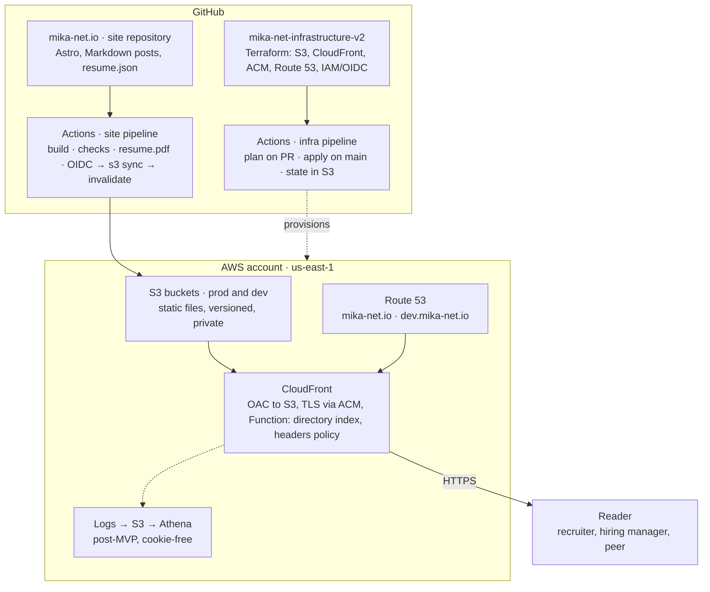
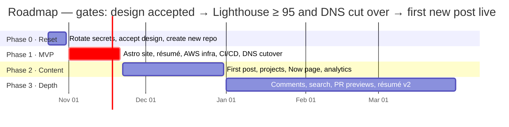

<!--
  Source of truth: this file. It was exported on 2026-10-24 from the Claude Doc at
  https://claude.ai/artifact/1WvrGJ1ghHRV55CxgP2n2h after all decisions were accepted.
  From this point, edit here and record decision changes in section 15 and in docs/adr/.
  Agents: read docs/requirements/00-overview.md before acting on anything in this file.
-->

# mika-net.io — Design Document

24 Oct 2026 · Michael Johnson · v1.0 (all decisions accepted)

## Status and how to read this

This is draft v0.1, written 24 Oct 2026 from a survey of the three `Mika-net` repos, the live site, and Michael's résumé. Every architectural choice is marked **Proposed** until Michael accepts it in the decision log (section 15); nothing here is settled by being written down.

The document is deliberately bounded. The 2025 rebuild stalled because scope grew without a written limit, so this document has a hard timebox: final by **31 Oct 2026**, after which the only edits are decisions changing status. Sections 1–4 define what the site is for; 5–11 define what gets built; 12–16 define what does not, in what order, and what happens to the existing assets.

The guiding constraint, carried over from the first post on the live site ("Always be shipping", 16 Dec 2022): the site is live before it is good, and every iteration is small enough to finish.

## 1. Purpose and success criteria

mika-net.io exists to make the case for Michael Johnson as a Lead-or-above engineer legible in under a minute, and to give him a place to publish. The target readers sit at top-tier technology firms (Google, Amazon, Microsoft, Meta and peers) and at the technology practices of the big-three strategy consultancies (McKinsey Digital/QuantumBlack, BCG X, Bain Vector). The site has a third, subordinate purpose: its own architecture, pipeline and infrastructure are a worked example of how Michael builds, and are written up as such.

The current site works against the first purpose. Its last post is dated 7 Mar 2023, it has no navigation, no About page and no résumé, and it still carries template scaffolding. A reader who finds it today sees an abandoned project. Doing nothing is therefore not neutral.

### Success criteria

| Criterion | Target | How measured |
| --- | --- | --- |
| MVP live on mika-net.io | by **21 Nov 2026** | DNS points at the new stack; the old Amplify app retired |
| Time from Markdown commit on `main` to production | < 10 minutes | GitHub Actions run duration |
| Lighthouse (home page and one post, mobile) | ≥ 95 Performance, Accessibility, Best Practices, SEO | Lighthouse CI in the pipeline, enforced as a budget |
| Largest Contentful Paint on a post, simulated 4G | < 1.5 s | Lighthouse CI |
| Publishing cadence | ≥ 1 long-form post per quarter; Now page updated monthly | Post dates; Now page `updated` field |
| Résumé freshness | web page, PDF and JSON-LD all generated from one source file on every build | No hand-edited `.docx` in the repo |
| Monthly AWS cost | < US$5 | AWS Budgets alarm at US$10 |
| Qualified inbound contact | tracked per quarter, baseline 0 | Contact-form or email submissions tagged by source |
| Zero secrets in git | 0 | gitleaks scan in CI blocks merge |

### What failure looks like

Failure is a repeat of 2025: a month of infrastructure work, no post published, and the live site unchanged. The roadmap in section 14 is ordered so that the public site improves at every phase boundary, and the non-goals in section 13 name the specific rabbit holes.

## 2. Audience and the thirty-second path

Four readers matter, and they arrive with different time budgets and different questions. The home page is designed for the first two; the rest of the site is designed for the second two.

| Reader | Time budget | Arrives from | Needs to find, in order | Leaves with |
| --- | --- | --- | --- | --- |
| Recruiter or sourcer | 30 seconds | LinkedIn profile link, Google search on the name | Current title and scope; stack keywords; location/remote; résumé PDF; contact | A PDF forwarded internally |
| Hiring manager or bar-raiser (big tech) | 5 minutes | Recruiter forward, interview prep | Evidence of scope and impact (team of 9, millions of users, incidents −87.3%); one post showing technical judgement; signs of ownership | A specific question to ask in the interview |
| Consulting tech-practice interviewer (MBB) | 5 minutes | Application, referral | Client-facing history (Slalom Build, CapTech); structured writing; business framing of technical decisions; proposal work | Confidence Michael can sit in front of a client |
| Peer engineer | Open-ended | Search, RSS, a shared link, GitHub | The writing itself; code; RSS feed | A subscription or a reply |

### The thirty-second path

Above the fold on the home page, in this order, with no scrolling on a 390 px phone or a 1280 px laptop:

1. Name and one-line positioning: *Michael Johnson — Lead Engineer. Cloud-first, event-driven systems on AWS and .NET; teams that ship daily without outages.*
2. Three proof points as plain numbers, each linked to its evidence: 9 engineers led; millions of users served; production incidents cut 87.3%.
3. Three actions: **Résumé** (web, with PDF one click away), **Writing**, **Contact**.
4. Below the fold: the three most recent or most representative posts, then selected projects.

Everything a recruiter needs is reachable without JavaScript and is present in the HTML, so it also survives link previews, text-mode crawlers and screen readers.

### Evidence for the design

Seven in ten US employers research candidates online and 57% have found content that led them not to hire ([CareerBuilder/Harris Poll, 2018](https://resources.careerbuilder.com/employer-blog/70-of-employers-use-social-networking-sites-to-research-candidates-during-hiring-process)). That survey covers social media rather than personal sites, and no comparable study of developer blogs was found; the thirty-second path is a design judgement, not a measured result. It will be checked against real behaviour once analytics exist (section 8, decision D5).

## 3. Positioning and identity

The site is Michael Johnson's; *Lessons Distilled* is the name of the writing within it, not of the site. That split resolves the tension between "keep the identity" and "I go by Michael now": the domain and the imprint keep the Mika heritage, and the person on the page is Michael.

| Element | Decision (Proposed) | Note |
| --- | --- | --- |
| Site name and `<title>` | Michael Johnson | Appears as `Post title · Michael Johnson` on inner pages |
| Byline on posts | Michael Johnson | The résumé already reads *Michael "Mika" Johnson*; the nickname can appear once on About to explain the domain |
| Writing imprint | Lessons Distilled | Section heading and RSS feed title: *Lessons Distilled — writing by Michael Johnson* |
| Tagline | Lessons learned from building things | Carried over; short, true to the content |
| Domain | mika-net.io | Keep; `www` redirects to apex |
| Social handles | GitHub, LinkedIn, Stack Overflow | Carried over from the current footer; LinkedIn "Website" field points here |

### The narrative the site must make legible

The résumé already contains the story; the site's job is to tell it in the right order. Michael is a lead engineer who runs the only team supporting a healthcare-navigation product used by millions, is the sole 24/7 on-call engineer under a zero-outage policy, and cut production incidents by 87.3% through quality gates and design changes. Before that he was a consultant (Slalom Build, CapTech), which is the credential the MBB reader is looking for, and he has a specific, quantified technical result (Native AOT cold starts down 86%) that is a natural first post.

The positioning sentence for Lead+ readers therefore leads with operating production at scale and building teams that ship, and only then names the stack. Big-tech bar-raisers hire for scope and judgement; consulting practices hire for structured communication and client comfort. Both are leadership signals, and both are already true. The stack keywords (.NET, AWS Lambda, DynamoDB, event-driven, Angular, React) belong in the résumé and in `<meta>` tags for recruiters' searches, not in the headline.

### Voice

First person, plain, specific, with numbers. The existing posts have the right instinct ("any code that isn't delivered isn't worth anything") and the wrong polish (typos, a template excerpt left in place). The editorial standard for new posts: each post states its lesson in the first paragraph, shows the evidence, and says what Michael would do differently. Humour is fine; apostrophes are mandatory.

## 4. Content strategy

Four pillars, each tied to a reader from section 2. A post that fits none of them is still allowed, but the pillars decide what gets written first.

| Pillar | What it demonstrates | For whom | First candidate posts |
| --- | --- | --- | --- |
| Running production | Operating under a zero-outage policy; incident reduction; the "desk check" review practice; release cadence | Big-tech hiring managers | *How a desk check cut our incident rate by 87%*; *Being the only on-call engineer for millions of users* |
| Architecture on AWS and .NET | Event-driven and serverless design; cost and cold-start trade-offs; data modelling | Big tech, peers | *Native AOT .NET 8 on Lambda: what 86% faster cold starts cost*; *Rockset over DynamoDB for admin reporting* |
| Engineering judgement | Scope, trade-offs, saying no; client-facing framing | MBB tech practices | *I built a three-tier backend for a four-post blog: a post-mortem on scope*; *Writing the technical proposal before the code* |
| AI-assisted engineering | Continuation of the 2022–23 theme, now from a lead's seat: how a team of nine uses these tools and what review has to change | All | *What AI coding tools changed about code review on my team* |

The site itself is a fifth, implicit pillar: each infrastructure decision in section 8 is written up once as a short post. That is how the architecture earns its place as portfolio (section 8, guiding principle).

### Cadence that ages well

Michael committed to quarterly or better. The design assumes exactly one substantial post per quarter (1,500–3,000 words) and makes the site look alive between posts by other means: a **Now** page with a visible `updated` date, refreshed monthly in five minutes; project pages that carry date ranges rather than "recent"; and a home page that shows representative posts, not a reverse-chronological feed that advertises the gap. If the cadence turns out to be higher, nothing needs to change.

### The four existing posts

Keep all four at their current URLs (section 5). They are honest, dated and part of the record. Edits are limited to: fixing typos and apostrophes ("Tonights" → "Tonight's"); rewriting the excerpt of *"Code"-pendent on AI*, which is generic and does not mention ChatGPT despite the slug; and adding a one-line *2026 note* at the top of each where Michael's view has moved. The cover-image requirement goes away; the existing images stay.

### Salvage backlog from the 2025 work

Nothing from the mid-2025 rebuild ships as code on the site. Three pieces of it ship as writing, which is where their value is:

1. The .NET 8 Native AOT Lambda API (`mika-net-api`, 26 KB design document, working controllers, tests) becomes the Native AOT post, with real cold-start measurements taken before the stack is deleted.
2. The decision to build GitHub-authenticated comments on DynamoDB, when [giscus](https://giscus.app) provides the same thing on GitHub Discussions with no backend, becomes the scope post-mortem.
3. The Terraform repository is reused for the new hosting (section 8) and its evolution is the infrastructure write-up.

## 5. Information architecture and URLs

Five top-level sections, four of them in the navigation. Every URL is a directory with a trailing slash, served as `index.html`, so the site works from a plain object store with no rewrite rules.

| URL | Page | In nav | Notes |
| --- | --- | --- | --- |
| `/` | Home | — | The thirty-second path (section 2) |
| `/posts/` | Writing index (*Lessons Distilled*) | Writing | Grouped by year; pillar filter is a later addition |
| `/posts/[slug]/` | Post | — | **Unchanged from the current site**, so the four existing URLs keep working with no redirects |
| `/tags/[tag]/` | Posts by tag | — | Generated only for tags with ≥ 2 posts |
| `/projects/` and `/projects/[slug]/` | Projects | Projects | One page per project, with period, role, stack and links to posts |
| `/resume/` | Résumé (web) | Résumé | Section 7; `/resume.pdf` and `/resume.json` sit beside it |
| `/about/` | About, with contact | About | Contact is a section of About (`/about/#contact`), not a separate page |
| `/now/` | Now | — | Linked from About and the footer; dated |
| `/rss.xml`, `/sitemap-index.xml`, `/robots.txt` | Feeds and crawl files | — | Section 10 |
| `/404.html` | Not found | — | CloudFront custom error response maps 403/404 from S3 to it |

### Why `/posts/` stays

Renaming to `/writing/` reads slightly better and costs a redirect mechanism (a CloudFront Function with a slug map) for four URLs with little inbound traffic. The URL is the stable part; the navigation label, *Writing*, is the readable part. If the mechanism exists later for another reason, this can be revisited.

### Navigation

Header: name (links home) · Writing · Projects · Résumé · About. Footer: Now · RSS · GitHub · LinkedIn · Stack Overflow · email · colophon link to the post about how the site is built. No mega-menus, no search box until Pagefind is added (decision D6).

## 6. Content model

All content is files in the repository, validated at build time against schemas. There is no database and no CMS (section 13). Five collections cover everything in section 5.

| Collection | Source | Required fields | Optional fields |
| --- | --- | --- | --- |
| `posts` | `src/content/posts/<slug>/index.md` (or `.mdx`), images beside it | `title`, `description` (≤ 160 chars), `pubDate`, `pillar` (one of four) | `updatedDate`, `tags[]`, `series`, `heroImage`, `draft`, `canonicalURL`, `note2026` |
| `projects` | `src/content/projects/<slug>.md` | `title`, `summary`, `period.start`, `role`, `stack[]` | `period.end` (absent = ongoing), `links.repo`, `links.live`, `links.post`, `featured`, `status` |
| `now` | `src/content/now/<date>.md` | `updated`, body | — (latest entry is rendered; history kept) |
| `resume` | `src/data/resume.json` | JSON Resume schema (section 7) | — |
| `pages` | `src/content/pages/about.md` | `title`, body | `updatedDate` |

Schemas are Zod definitions in Astro's content collections, so a missing `description` or a malformed date fails the build rather than shipping ([Astro docs, "Content collections"](https://docs.astro.build/en/guides/content-collections/)). The four existing posts migrate with a one-time script: `excerpt` → `description`, `date` → `pubDate`, `coverImage` → `heroImage`, `author` dropped (single-author site), `ogImage` dropped (generated at build, section 10).

### Conventions

- Slugs are the directory name, lower-case, hyphenated, never changed after publishing. The four existing slugs (`shipping`, `SMTP`, `ai-plugins`, `ai-plugins-chatgpt`) are kept exactly, including the upper-case `SMTP`, because the URL already exists in the wild.
- Images live next to the post that uses them and are referenced relatively, so a post is a self-contained folder that can be moved or deleted as a unit.
- `draft: true` posts build locally and in the dev environment, never in production.
- Dates are ISO 8601 with a time zone offset; display is `17 Dec 2022` style, chosen once in a formatter.
- Reading time is computed at build, not stored.
- A `pillar` is mandatory and a `tag` is optional: pillars are the four from section 4 and drive the Writing index grouping; tags are free-form and only get index pages at two or more posts.

## 7. The résumé as a product

One structured file, `src/data/resume.json`, is the only place the résumé is edited. The build renders it three ways: the web page at `/resume/`, a PDF at `/resume.pdf` produced by printing that same page with headless Chromium in CI, and `schema.org/Person` JSON-LD on the home and About pages. The `.docx` Michael maintains today is retired once the PDF matches it; the attached résumé is the seed for the JSON.

The file follows the [JSON Resume schema](https://jsonresume.org/schema) (`basics`, `work[]`, `skills[]`, `education[]`, `projects[]`) with two small extensions: each `work[].highlights[]` entry may carry `lenses[]` and `evidence` (a URL to a post or project on this site), and `skills[]` carry no typed `years`, because years are computed from `work[]` dates at build.

### Behaviour of `/resume/`

The default view is the plain résumé, identical in content and order to the PDF, with the **Download PDF** link in the first screen. Recruiters and applicant-tracking systems get exactly what they expect: real HTML text, no canvas, no SVG-rendered copy. Everything below is progressive enhancement and the page is complete without JavaScript.

1. **Role timeline.** An SVG drawn from `work[]` dates (2017 → present) above the text, with stack per role on hover. It gives the five-minute reader the shape of the career in one glance and makes the gap-free progression visible.
2. **Lenses.** Three toggles, *Leadership*, *Architecture*, *Consulting*, that highlight the bullets tagged for that lens and dim the rest. Nothing is hidden and order does not change, so a reader never loses their place. Default is no lens.
3. **Evidence links.** Any number in the résumé that has a post behind it (87.3% incident reduction, 86% cold-start improvement) links to it. This is the single strongest differentiator against a PDF: claims a reader can check.
4. **Computed facts.** Years of experience, years per skill and "currently" are derived from dates at build, so the résumé never says "nine years" in year ten.
5. **Print stylesheet.** `@media print` produces a two-page A4/Letter layout with URLs expanded in footnotes; the CI PDF is this view, so what a reader prints from the browser and what they download are the same document.

### What the web version omits

The phone number stays out of the public page and PDF; email and LinkedIn are enough for first contact and the number is on the version Michael sends directly. Street-level location is replaced by *Chicago area · remote*.

### Later, if wanted

A tailored-PDF generator (pick a lens, download a one-page version) is a natural extension and a good Astro island exercise. It is not in the MVP; the plain PDF is.

## 8. Technical architecture

A static site built by Astro, delivered from S3 through CloudFront, provisioned by Terraform and deployed by GitHub Actions over OIDC. No servers, no database, no runtime secrets. Everything that runs in production is a file.

The left column is the site: a commit to the site repository runs the pipeline, which writes files to S3 and invalidates CloudFront. The right column is the infrastructure: Terraform changes go through their own pipeline and provision everything inside the AWS box. Nothing in the AWS box runs code except the four-line CloudFront Function.

### Guiding principle: infrastructure is portfolio only when written up

Michael wants the architecture to count as a demonstration, and the 2025 attempt shows how that goal inflates scope. The rule that bounds it: a component ships only if its purpose fits in one sentence a hiring manager would understand, and it is written up (a post or a colophon entry) within the phase it ships. A component that cannot be explained that simply is not a demonstration of judgement; it is a demonstration of time.

### Decision records

Each decision is proposed here and tracked in section 15. Full ADRs live as `docs/adr/NNNN-title.md` in the site repository once accepted.

| ID | Decision (Proposed) | Alternatives considered | Why this one |
| --- | --- | --- | --- |
| D1 | **Astro 5** with content collections, MDX and TypeScript strict; Node LTS; pnpm | Next.js static export (current stack); Hugo; Eleventy | Content-first by design: typed frontmatter, zero client JavaScript unless an island asks for it ([Astro docs, "Islands"](https://docs.astro.build/en/concepts/islands/)). Next.js is an application framework, and its API routes were the on-ramp to the 2025 sprawl. Hugo has no island model for the résumé page. |
| D2 | **S3 + CloudFront** with Origin Access Control, ACM certificate, Route 53 hosted zone; one `prod` and one `dev` bucket behind two distributions (`mika-net.io`, `dev.mika-net.io`); all in Terraform in `mika-net-infrastructure-v2` | Cloudflare Pages; Vercel (current host) | Michael chose the architecture-as-portfolio path. This is the bounded version: roughly US$1–2/month, every resource in code, nothing to patch. Amplify, Vercel and Cloudflare are the right answer for anyone who did not make that choice. |
| D3 | **GitHub Actions** with OIDC federation to AWS: build, test, Lighthouse CI budget, render `resume.pdf`, `aws s3 sync`, CloudFront invalidation; `terraform plan` on PR and `apply` on merge in the infra repo | Amplify's Git-connected build (current); Vercel; AWS CodePipeline | No long-lived AWS keys: the workflow exchanges a GitHub-issued token for short-lived credentials, with the role trust policy scoped to this repository and branch ([GitHub Docs, "Configuring OpenID Connect in AWS"](https://docs.github.com/en/actions/security-for-github-actions/security-hardening-your-deployments/configuring-openid-connect-in-amazon-web-services)). The existing pipeline is Amplify console configuration, invisible to anyone reading the repo; this one is code. |
| D4 | **Comments via giscus**, Phase 3, on posts only | Build GitHub-auth comments on DynamoDB (2025 approach); no comments | Same user-facing result as the 2025 design with zero backend: comments live in GitHub Discussions on the repo ([giscus](https://giscus.app)). "No comments at all" remains acceptable and is the default until Phase 3. |
| D5 | **Analytics from CloudFront standard logs** to S3, queried with Athena; no client-side script, no cookies, no consent banner | Plausible (paid); Cloudflare Web Analytics (requires a script); Google Analytics | Answers the only questions that matter (which pages, from where, how often the PDF is downloaded) with data Michael already owns. AWS-native and worth one post. |
| D6 | **Search with Pagefind**, added when the archive passes \~15 posts | Algolia; no search | Static index built at deploy time, loaded on demand; nothing to run. Not needed for four posts. |
| D7 | **Images and OG cards at build**: Astro `<Image>` (sharp) for responsive images; per-post Open Graph images generated at build from the title | Hand-made cover images (current requirement); a third-party OG service | Removes the "I need a cover image" friction that slows posting; every post gets a correct social card for free. |
| D8 | **Edge behaviour in CloudFront**: a CloudFront Function rewrites `/path/` to `/path/index.html` and redirects `www` to the apex; a response-headers policy adds HSTS, CSP, `X-Content-Type-Options` and `Referrer-Policy`; custom error response serves `/404.html` | S3 static-website endpoint (serves index documents natively but is HTTP-only and incompatible with OAC) | OAC requires the S3 REST origin, which does not resolve directory indexes; the function is the standard four-line fix and keeps the bucket private. |

### Remote Terraform state

State moves from the laptop to an S3 bucket with versioning, encryption and the backend's native lockfile (`use_lockfile = true`). The DynamoDB lock table the 2025 `backend.tf` planned for is unnecessary: HashiCorp now documents DynamoDB-based locking as deprecated and slated for removal ([Terraform docs, "S3 backend"](https://developer.hashicorp.com/terraform/language/backend/s3)). The state bucket itself is the one resource created by hand, once, and documented.

### Environments

`main` deploys to production. Any pull request deploys to `dev.mika-net.io` (last writer wins, acceptable for a single author) and the workflow posts the URL on the PR; `dev` carries `X-Robots-Tag: noindex` from its headers policy. Per-PR preview URLs are a Phase 3 refinement and get their own ADR if they happen.

## 9. Visual design principles

This is a reading site, so typography carries the design and everything else stays out of its way. The current black-background card layout is the template's, not a choice; it goes.

1. **Type first.** One serif for body text (candidates: Source Serif 4, Newsreader, Literata), one sans for interface and headings (Inter or IBM Plex Sans), one mono for code (JetBrains Mono or IBM Plex Mono). All self-hosted, subset to Latin, `font-display: swap`, three files total. Measure 65–75 characters; body 18 px on desktop, 17 px on phones; line height 1.6.
2. **Light and dark, both designed.** Colour tokens on `:root`, dark values under `prefers-color-scheme: dark`, with a toggle that remembers the choice. Contrast ≥ 4.5:1 for text in both themes; the accent is used for links and one highlight, never for decoration.
3. **No cover images by default.** Posts open with the title, date, reading time and pillar. A hero image is allowed when the post has one worth showing. The home page uses no stock photography.
4. **Layout.** Single column, maximum 72 ch for prose, wider only for code blocks and tables, which may bleed to 90 ch. The résumé page is the one two-column layout (dates in a left gutter) and collapses to one column under 640 px.
5. **Performance budget**, enforced in CI (section 11): 0 KB JavaScript on content pages; ≤ 40 KB JavaScript (gzipped) on the résumé page for its islands; ≤ 120 KB total fonts; images responsive and lazy below the fold; LCP < 1.5 s, CLS < 0.1 on simulated 4G.
6. **Accessibility baseline.** WCAG 2.2 AA: semantic landmarks, one `h1` per page, visible focus rings, skip link, `prefers-reduced-motion` respected, code blocks with language labels, images with real alternative text. Checked by axe in Lighthouse CI and by a keyboard-only walkthrough before each phase ships.
7. **One distinctive element.** A site with none of the template look needs one thing that is its own. Candidate: the role timeline from section 7, reused in miniature on the home page under the proof points. Decided during MVP build, not here.

### Aesthetic direction (added 24 Oct 2026)

Michael's preference is cyberpunk and hacker aesthetics. The site adopts a **restrained terminal** version of it: dark theme by default on a near-black blue rather than pure black, IBM Plex Mono for headings, navigation, metadata and code, IBM Plex Sans for body text, and a single phosphor accent with one secondary colour. (Revised 3 Nov 2026: the accent is VT220 amber on warm graphite, the secondary a soft green — the original green-on-blue-black read as HackerRank's palette; ADR-0011 amendment.) Terminal idioms carry the mood: prompt markers on section headings, a blinking cursor in the home hero (off under `prefers-reduced-motion`), box-drawing rules, and metadata lines set like key=value pairs. The light theme is a deliberate "paper" mode, not an afterthought.

The restraint is for the reader in section 2, not against the aesthetic: neon glows, gradients, glitch and scanline animations and Matrix-style effects read as hobbyist to a hiring manager at the firms Michael is targeting and cost performance and legibility. The full token set, type scale and the list of permitted and forbidden motifs are in `docs/requirements/03-frontend.md` in the site repository (decision V1).

The visual pass happens on real pages during the MVP build, not on mock-ups; a separate design phase is not part of this plan. The seven principles above are the brief for that pass.

## 10. Discoverability

The site must be found by name (a recruiter searching "Michael Johnson" plus a stack keyword, or following the LinkedIn link) and by topic (an engineer searching for Native AOT cold starts). Both are solved at build time with no third-party service.

| Mechanism | Implementation | Purpose |
| --- | --- | --- |
| Sitemap | `@astrojs/sitemap`, excluding `draft` and `dev` | Crawl coverage |
| RSS | `@astrojs/rss` at `/rss.xml`, full content, titled *Lessons Distilled — writing by Michael Johnson* | Peers; the only subscription mechanism at MVP |
| Open Graph and Twitter cards | Per-page `og:title`, `og:description`, `og:image` (generated, D7), `og:type` article/profile | Link previews on LinkedIn, Slack, X |
| JSON-LD | `Person` on home and About, generated from `resume.json` (name, jobTitle, worksFor, sameAs → GitHub, LinkedIn, Stack Overflow); `BlogPosting` on posts; `BreadcrumbList` on inner pages | Name search: a knowledge-panel-style result tying the profiles together |
| Canonical URLs | `<link rel="canonical">` on every page; `www` → apex 301 at CloudFront (D8) | One URL per page in search |
| `rel="me"` | On the footer profile links | Identity verification for Mastodon-style services, harmless otherwise |
| Search Console and Bing Webmaster | DNS-verified, sitemap submitted at launch | Index monitoring; catches broken URLs after cutover |
| Profile links | LinkedIn "Website", GitHub profile README, Stack Overflow "About me" all point here | The highest-traffic referrers for the recruiter reader |
| `humans.txt` and colophon | A short page on how the site is built, linked in the footer | The infrastructure-as-portfolio pillar, visible |

Two things are deliberately absent: a newsletter (section 13) and any tracking pixel. If a newsletter is ever wanted, the RSS feed is the source and a third-party service turns it into email; the site does not collect addresses.

## 11. Authoring and deployment workflow

Publishing a post is a pull request. The whole path from a blank file to production is designed to take less friction than the current site's, which required a cover image, an `ogImage` and an author block before anything rendered.

### Writing

1. `pnpm new post "Title"` creates `src/content/posts/<slug>/index.md` with the frontmatter skeleton, `draft: true`, and today's date.
2. Write in Markdown; `pnpm dev` renders it locally with live reload. MDX is available for the rare post that needs a component.
3. Open a pull request. The pipeline builds, runs the checks below, deploys to `dev.mika-net.io` and comments the URL on the PR.
4. Read it on a phone from the dev URL. Fix. Set `draft: false`. Merge. Production updates within ten minutes.

### Checks that gate a merge

| Check | Tool | Fails the build when |
| --- | --- | --- |
| Content schema | Astro content collections (Zod) | A required field is missing or malformed |
| Type check | `astro check` | TypeScript errors in components |
| Links | lychee over the built HTML | An internal link 404s; external failures warn only |
| Lighthouse budget | Lighthouse CI against the dev deployment | Any category < 95 on home or the newest post, or the JavaScript budget is exceeded |
| Accessibility | axe (within Lighthouse CI) | Serious or critical violations |
| Secrets | gitleaks | Any credential-shaped string in the diff |
| Résumé PDF | Playwright renders `/resume/` to `resume.pdf` and checks page count ≤ 2 | The résumé spills to a third page |

### Review checklist before `draft: false`

- [ ] First paragraph states the lesson
- [ ] `description` is ≤ 160 characters and reads as a sentence
- [ ] At least one concrete number, date or code sample
- [ ] Open Graph image renders with the full title
- [ ] Post is assigned a pillar; tags exist or are new on purpose
- [ ] Read once on a phone

### Publishing rhythm

At the start of each quarter Michael picks the one post for that quarter from the pillar backlog (section 4) and opens its draft PR on day one, so the quarter's commitment is visible in the repository, not in his head. The Now page is updated on the first weekend of each month; it takes five minutes and is the heartbeat that keeps the site looking current between posts.

## 12. Security, operations and cost

A static site has almost no attack surface, which is the point; what remains is the supply chain, the deploy credentials and the secrets already leaked into git.

### Immediate: rotate the leaked credentials (by Oct 31, 2026)

The survey found `.env.production` committed to the `Mika-net` repository in commit `6f29521` (28 Jun 2025) with a GitHub OAuth client ID, a 40-character client secret and the `NEXTAUTH_SECRET`; `DEPLOYMENT.md` in the same repository repeats the `NEXTAUTH_SECRET` at line 30. Whether or not the repository is public, these are compromised by policy.

- [ ] Regenerate or delete the GitHub OAuth App (the app is not needed by the new site)
- [ ] ~~Rotate `NEXTAUTH_SECRET`~~ — never deployed (unmerged branch); nothing to rotate (noted 3 Nov 2026)
- [ ] Delete both files from the working tree; if the repository will ever be public, rewrite history with `git filter-repo` and force-push, then invalidate forks
- [ ] Confirm `terraform.tfstate` on the laptop contains no secret values, then migrate state to the remote backend (section 8) and delete the local copies
- [ ] Add gitleaks to CI in every repository before any new code lands

### Deploy credentials

No AWS access keys exist anywhere. GitHub Actions assumes two IAM roles over OIDC: a site-deploy role that can only `PutObject`/`DeleteObject` on the two site buckets and `CreateInvalidation` on the two distributions, and an infra role used by the Terraform pipeline with the permissions Terraform needs, trusted only from the `mika-net-infrastructure-v2` repository's `production` environment for `apply`. Role trust policies pin the repository and branch in the `sub` claim.

### Supply chain

Renovate (or Dependabot) opens weekly PRs for npm and Terraform providers; `pnpm` lockfile is committed; Actions are pinned to commit SHAs, not tags. A CSP with no `unsafe-inline` for scripts is set at the edge (D8), which also constrains any island code to what the build emitted.

### Backups and recovery

Content is in git, which is the backup. Both site buckets have versioning on with a 30-day noncurrent-version expiry. The state bucket has versioning on indefinitely. Recovery from a bad deploy is a re-run of the previous successful workflow; recovery from a lost AWS account is `terraform apply` into a new one plus a DNS change at the registrar.

### Cost

| Item | Monthly estimate (US$) | Note |
| --- | --- | --- |
| Route 53 hosted zone | 0.50 | Fixed |
| S3 storage and requests (site, state, logs) | < 0.10 | Site is a few MB |
| CloudFront | 0.00–1.00 | Free tier covers 1 TB/month of egress; the function and invalidations are within free limits at this traffic |
| ACM certificate | 0.00 | Free for CloudFront |
| Athena queries (D5, post-MVP) | < 0.10 | Pennies per scan at this log volume |
| GitHub Actions | 0.00 | Public repository minutes are free; private repositories have 2,000 free minutes/month |
| Domain renewal | \~3.00 amortised | Already paid annually |

Total is under US$5 per month, as the success criteria require. An AWS Budget alarm at US$10 emails Michael, so a misconfiguration (a public bucket being scraped, a logging loop) is caught within a day.

## 13. Non-goals

Each item below is something the 2025 rebuild either built or was heading toward. None ships without a written need in the decision log and a post that explains it.

| Non-goal | Why not | What replaces it |
| --- | --- | --- |
| Custom authentication (GitHub OAuth, NextAuth) | A read-only site has no users to authenticate | giscus authenticates commenters on GitHub's side (D4) |
| A backend API (the .NET Lambda, API Gateway) | Nothing on the site needs a request-time computation | Build-time generation; the API becomes a post (section 4) |
| A database (DynamoDB, Vercel KV) | Content is files; comments are GitHub Discussions | Git |
| A CMS or admin UI | One author who is comfortable in Markdown and git | `pnpm new post` and a pull request |
| Per-PR preview environments at MVP | Adds a wildcard certificate, a routing function and cleanup jobs for a single author | One `dev` environment; revisit in Phase 3 |
| Newsletter or email capture | Collecting addresses creates an obligation and a data-protection surface | RSS; a third-party RSS-to-email service if ever wanted |
| Client-side rendering of pages | Zero JavaScript on content pages is a design goal and a performance budget | Astro islands only where a page needs interaction (résumé) |
| Internationalisation | Audience is English-speaking employers | None |
| A separate portfolio app or dashboard | The site is the portfolio | Project pages and the colophon |
| Rewriting old posts | They are dated and honest | A one-line 2026 note where views moved |

The other non-goal is procedural: this document is not revised during the MVP build except to change a decision's status. Design changes discovered while building are logged in section 15 as open questions and addressed after the MVP ships.

## 14. Roadmap and MVP definition

Four phases, each ending with the public site better than it was. The MVP ships by Nov 21, 2026, three weeks after the design is accepted, and it is the smallest site that serves all four readers in section 2.

The bands are not to scale: Phase 0 is one week, Phase 3 is a quarter. Each diamond is a gate that must be met before the next phase starts; the criteria under it are the ones from the phase descriptions below.

### Phase 0 — Reset (by Oct 31, 2026)

Rotate the leaked credentials (section 12). Accept or amend the decisions in section 15. Create a fresh `mika-net-v2` repository (public) for the site rather than building on `Mika-net`, whose history carries the secrets; the old repository is archived read-only after cutover. The Amplify deployment keeps serving until Phase 1 cuts over, so the live site never goes dark.

### Phase 1 — MVP (by Nov 21, 2026)

Definition of done, all required:

- [ ] Home, Writing index, the four migrated posts at their original URLs, About, Résumé (web and PDF), 404
- [ ] RSS, sitemap, Open Graph images, JSON-LD `Person` and `BlogPosting`
- [ ] Infrastructure in Terraform with remote state: state bucket, two site buckets, two CloudFront distributions, ACM certificate, Route 53 zone, CloudFront Function, headers policy, two OIDC roles
- [ ] Site and infra pipelines green, including the Lighthouse budget and gitleaks
- [ ] `dev.mika-net.io` deploys from pull requests with the URL commented on the PR
- [ ] Lighthouse ≥ 95 in all four categories on home and one post; résumé PDF ≤ 2 pages
- [ ] DNS cut over to CloudFront; `www` redirects; all four old URLs return 200
- [ ] Old repositories kept read-only for history; Amplify app deleted; GitHub OAuth App deleted
- [ ] A colophon page describing the stack in ten sentences

Not in the MVP: the résumé lenses and timeline (plain résumé ships first), Projects pages, Now page, analytics, comments, search.

### Phase 2 — Content (by Dec 31, 2026)

The first new post, which is the Native AOT piece because its measurements must be taken before the 2025 stack is deleted. Then Projects (three to five pages), the Now page, analytics from CloudFront logs with the post that explains it, the résumé timeline, and the external profile links updated to point here. Gate: one new post live and analytics answering "how many résumé downloads this month".

### Phase 3 — Depth (by Mar 31, 2027)

The second post (the scope post-mortem). giscus comments. Résumé lenses and evidence links. An ADR and, if accepted, implementation for per-PR previews. Pagefind only if the archive justifies it. By the end of this phase the site has six posts, every section of this document is live, and the quarterly rhythm is the only remaining work.

## 15. Decision log and open questions

Change a status here to accept, reject or defer a decision; the section that proposed it is the rationale. Anything still *Proposed* on 31 Oct 2026 is treated as accepted so the build can start.

| ID | Decision | Section | Status |
| --- | --- | --- | --- |
| ID1 | Site is *Michael Johnson*; *Lessons Distilled* is the writing imprint; byline Michael Johnson | 3 | Accepted |
| ID2 | Positioning leads with running production and leading teams, then the stack | 3 | Accepted |
| C1 | Four content pillars; one substantial post per quarter; Now page monthly | 4 | Accepted |
| C2 | The 2025 API and comment system ship as posts, not code | 4 | Accepted |
| U1 | `/posts/[slug]/` stays canonical; nav label is *Writing* | 5 | Accepted |
| R1 | Résumé from `resume.json` (JSON Resume schema) → web, PDF, JSON-LD; phone omitted from public versions | 7 | Accepted |
| D1 | Astro 5, content collections, MDX, pnpm | 8 | Accepted |
| D2 | S3 + CloudFront + ACM + Route 53 in Terraform; prod and dev | 8 | Accepted |
| D3 | GitHub Actions with OIDC; pipelines in the repositories | 8 | Accepted |
| D4 | giscus comments in Phase 3 | 8 | Accepted |
| D5 | Analytics from CloudFront logs via Athena; no client script | 8 | Accepted |
| D8 | CloudFront Function for index rewrite and `www` redirect; headers policy | 8 | Accepted |
| G1 | Fresh `mika-net-v2` repository (public); `Mika-net` archived after cutover | 14 | Accepted |
| G2 | MVP live by 21 Nov 2026 with the definition of done in section 14 | 14 | Accepted |
| V1 | Restrained cyberpunk/terminal aesthetic: dark-first, monospace headings and metadata, one phosphor accent; no neon glow, gradients, glitch or scanline effects (added 24 Oct after approval) | 9 | Accepted |

### Open questions for Michael

1. Are the three `Mika-net` GitHub repositories public or private today? A public repository makes the history rewrite in section 12 urgent rather than tidy.
2. Where is `mika-net.io` registered? If the registrar is not Route 53, the cutover is a name-server change there.
3. Which AWS account hosts the 2025 DynamoDB table and the API stack, and may both be deleted once the Native AOT measurements are taken?
4. The Native AOT post: the 86% figure on the résumé is CapTech client work. The post should re-measure on the `mika-net-api` code, which is Michael's own, and cite the client result only as the résumé does. Agreed?
5. Exact LinkedIn and Stack Overflow profile URLs for the `sameAs` links and the footer.
6. Is *Chicago area · remote* the right public location line?
7. Any sites whose typography or layout Michael admires, to anchor the visual pass in section 9. Optional; the defaults there stand without an answer.

## Appendix A — Inventory of existing assets

Surveyed 24 Oct 2026 in `~/Documents/repos` on Michael's machine. Dispositions follow sections 4, 8 and 14.

| Asset | Where | What it is | Disposition |
| --- | --- | --- | --- |
| Four posts | `Mika-net/_posts/*.md` (250–614 words each) | *Always be shipping.* (16 Dec 2022); *Misadventures in SMTP and IMAP* (26 Dec 2022); *How I Learned to Stop Worrying and Love the AI.* (28 Dec 2022); *"Code"-pendent on AI* (7 Mar 2023) | **Keep.** Migrate with the frontmatter script (section 6); typo pass; 2026 notes |
| Post images and author photo | `Mika-net/public/assets/blog/` | Cover images, author portrait, site preview image | **Keep** the covers beside their posts; new portrait optional |
| Favicons | `Mika-net/public/favicon/` | Template-generated set | **Replace** at MVP with a generated set from one SVG |
| Next.js site, `main` branch | `Mika-net` (GitHub: `Mika-net/Mika-net`, private) | The live 2023 build; blog-starter template | **Keep read-only** after cutover; keep serving on Amplify until then |
| GitHub auth + comments | `Mika-net` `feature/add-dynamodb` (commits 28 Jun – 27 Jul 2025, unmerged) | NextAuth GitHub OAuth, comments on file system / Vercel KV / DynamoDB, API client to the .NET service | **Salvage as content** (scope post-mortem); code not reused |
| Migration scripts | `Mika-net/scripts/*.ts`, `migrate-to-dynamodb`, `MIGRATION_GUIDE.md`, `DYNAMODB_SETUP.md` | Markdown → DynamoDB loaders and checks | **Archive** with the repository |
| OpenAPI contract | `Mika-net/swagger-external-api.yaml` (13 KB) | Contract for the .NET API | **Archive**; quote from it in the post if useful |
| Leaked secrets | `Mika-net/.env.production` (tracked), `Mika-net/DEPLOYMENT.md` line 30 | GitHub OAuth client secret, `NEXTAUTH_SECRET` | **Rotate now**, then delete; rewrite history if ever public (section 12) |
| .NET 8 Native AOT API | `mika-net-api` (GitHub: `Mika-net/mika-net-api`): controllers, services, SAM `template.yaml`, xunit tests, 26 KB design README | Serverless API for articles, auth and comments on DynamoDB | **Salvage as content** (Native AOT post with measurements), then **archive** and delete the stack |
| Terraform repository | `mika-net-infrastructure` (GitHub: `Mika-net/mika-net-infrastructure`) | DynamoDB table, Secrets Manager secret, IAM policies; `backend.tf` commented out; local `terraform.tfstate` | **Keep read-only for history** (revised 3 Nov 2026: the hosting stack lives in the new `mika-net-infrastructure-v2`); destroy the DynamoDB and secret resources from here after the measurements |
| Amplify app | AWS Amplify console (not in any repository); corrected 3 Nov 2026 — the survey assumed Vercel from the old repo's docs | Hosting and Git-connected CI for the live site | **Retire** at cutover |
| Résumé | `Michael_Johnson_Resume.docx` (attached, 614 words) | Current résumé | **Seed** for `resume.json`; the `.docx` is retired when the PDF matches |

## Sources

- Repository survey: `git log`, file listings and contents of the three repositories above, read 24 Oct 2026.
- Live site: [mika-net.io](https://mika-net.io), fetched 24 Oct 2026.
- [Astro docs — Islands architecture](https://docs.astro.build/en/concepts/islands/) and [Content collections](https://docs.astro.build/en/guides/content-collections/).
- [GitHub Docs — Configuring OpenID Connect in Amazon Web Services](https://docs.github.com/en/actions/security-for-github-actions/security-hardening-your-deployments/configuring-openid-connect-in-amazon-web-services).
- [HashiCorp — Terraform S3 backend](https://developer.hashicorp.com/terraform/language/backend/s3) (`use_lockfile`; DynamoDB locking deprecated).
- [giscus](https://giscus.app) — comments on GitHub Discussions.
- [JSON Resume schema](https://jsonresume.org/schema).
- [CareerBuilder / Harris Poll, 2018 — employers researching candidates online](https://resources.careerbuilder.com/employer-blog/70-of-employers-use-social-networking-sites-to-research-candidates-during-hiring-process).
- AWS price points in section 12 are from the public AWS pricing pages as of the author's knowledge and are approximate; the budget alarm, not the estimate, is the control.
